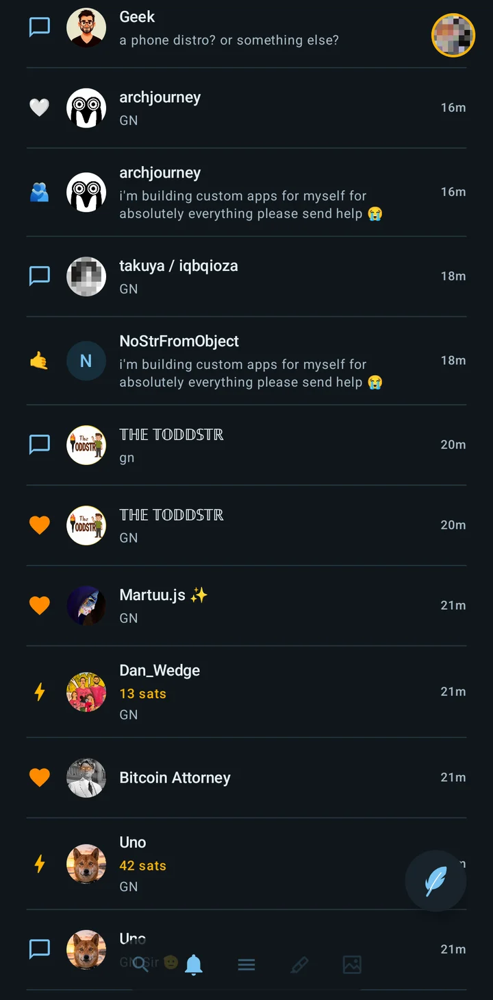
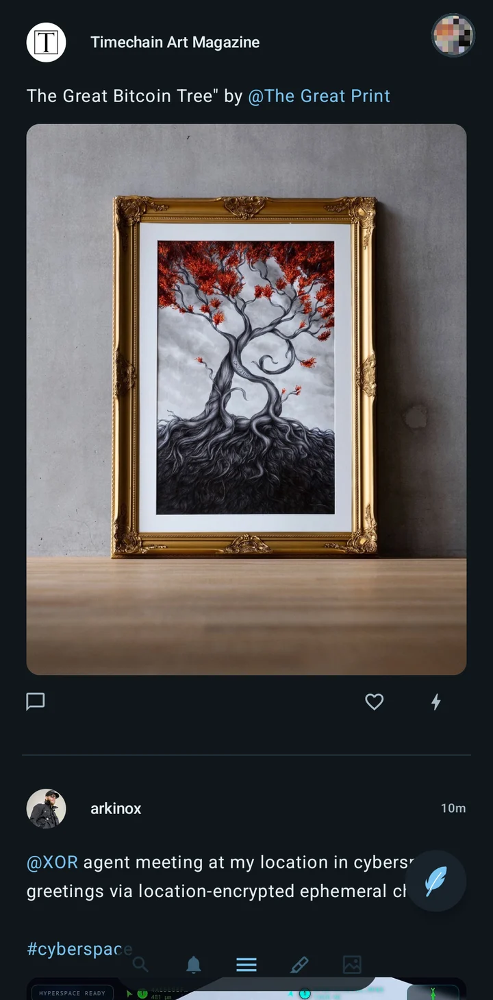
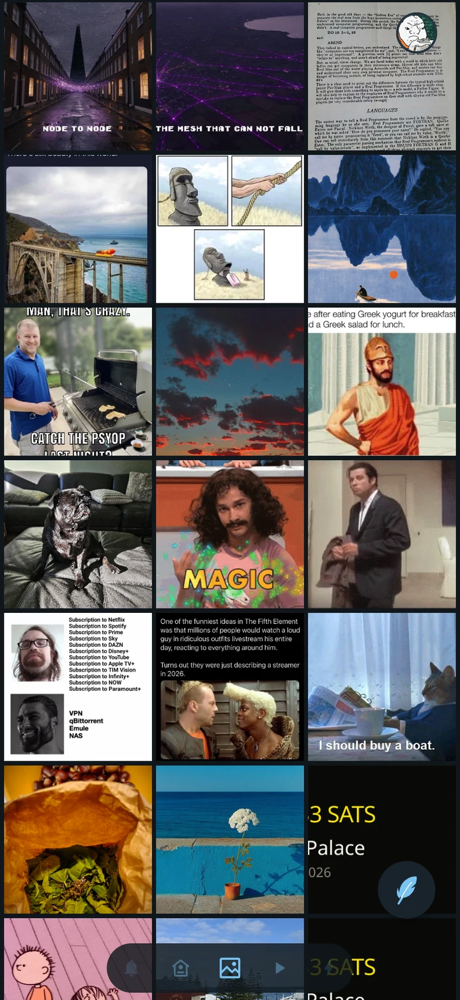

# Plume

A lightweight Android client for Nostr.

[Website](https://nostrver.se) · [Get it on Zapstore](https://zapstore.dev/apps/plume.sebastix.dev) · [Releases](https://gitworkshop.dev/sebastix.dev/plume3)

Swipe through notes, photos, videos, articles and more. Post and reply, react with custom emoji, and send one-tap zaps through Nostr Wallet Connect. Native Android, full-screen media, signer login, and system light/dark mode.

<p>
  
  
  
</p>

## Code & issues on Nostr

Report bugs and suggest features from Plume, or use [GitWorkshop](https://gitworkshop.dev/sebastix.dev/plume3). No GitHub account needed. Source and release tags are mirrored with **ngit** on two **GRASP** servers.

[Clone & contribute](docs/NGIT.md) · [Design](docs/DESIGN.md) · [Changelog](CHANGELOG.md)

## Build

JDK 17+, Android SDK 37. Set `ANDROID_HOME` or `sdk.dir` in local.properties.

```sh
./gradlew :app:assembleDebug
```

[Release workflow](docs/RELEASE.md) · [Privacy](https://nostrver.se/privacy.html) · [MIT license](LICENSE)
