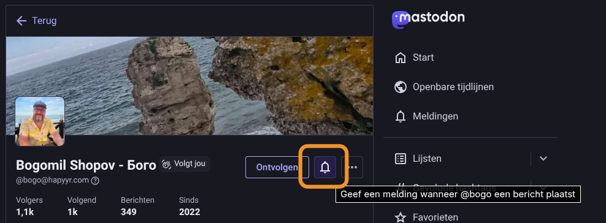
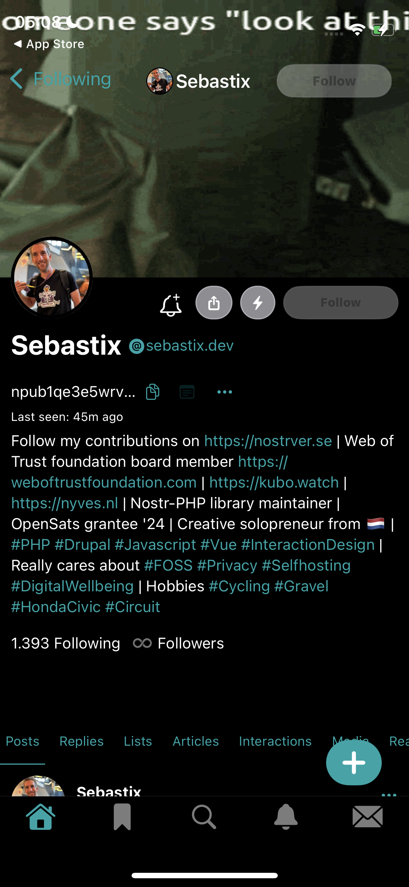
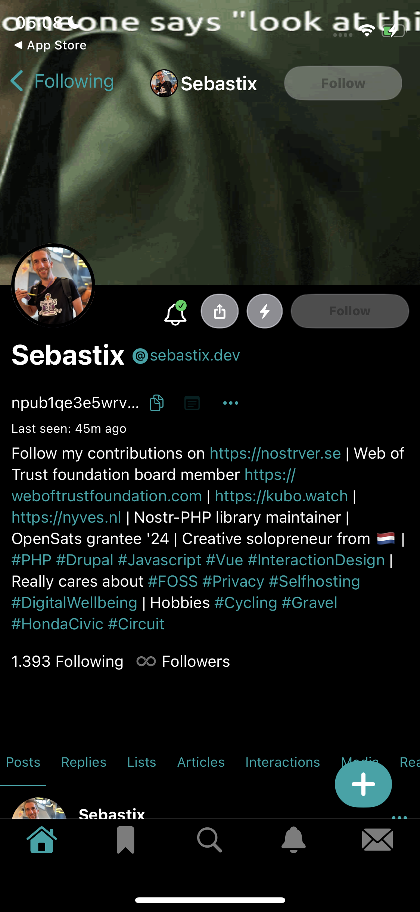
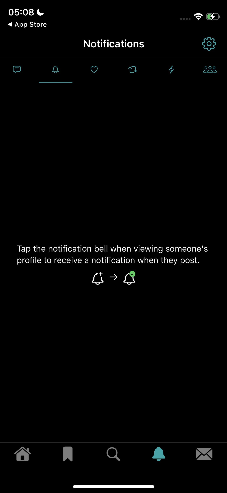
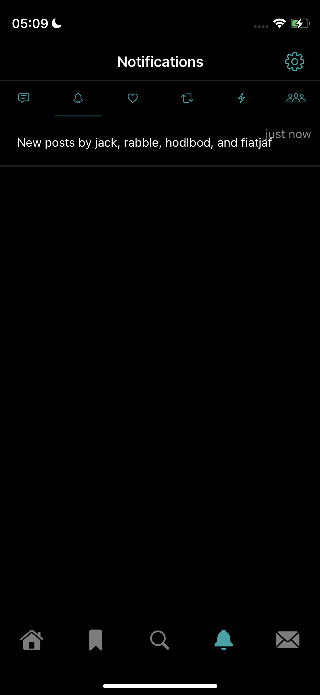

# Notifications from personal favorites: implementation plan

Status: plan only. Nothing here is implemented, and no release has been requested.

## Goal

A reader can mark any profile as a personal favorite. Favorites are stored only on this device. New activity from favorites appears in a separate home page, built for this purpose. There are no push notifications, no background polling, no OS notification permission and no network sync.

This is not a follow list. Plume never edits the account's Nostr follows, and favorites are never published.

## Decisions

These are my defaults. Change any of them before implementation starts.

1. **Scope:** favorites are stored per Nostr account on this device, like the NWC wallet. Guests have one shared guest list, so the feature works without login. Logging out hides the account's list and restores the guest list. Switching accounts never applies another account's favorites.
2. **What counts as a notification:** public activity authored by a favorite.
   - kind 1 posts and replies, kind 1111 comments
   - kind 6/16 reposts
   - kind 30023 articles
   - kind 20, 21 and 22 media
   - kind 9802 highlights
   - zaps sent by a favorite (kind 9735 receipts and kind 9321 nutzaps). Zaps a favorite receives are excluded. Individual zap previews use the existing layout: recipient, amount in the action colour (nutzaps in muted grey with their unit) and the zapped note.
   - Reactions made by a favorite are excluded. They are noise, and each costs an extra lookup.
3. **Name and placement:** the page is called Favorites in code. It is icon-only, so use a bell icon with an accessible description. It sits in the home pager beside Notifications and uses the same icon pill. It appears only while at least one favorite exists, so new installs see no change.
4. **Not a profile tab:** like Search and Notifications, it never appears as a profile tab.
5. **Cap:** at most 100 favorites. Adding past the cap shows a snackbar, and nothing is evicted silently.
6. **Aggregation and unread state:** activities are grouped per favorite. The page shows one aggregate row per favorite, carrying the number of that favorite's activities the reader has not seen yet. Each favorite has its own seen marker, updated when the reader opens or expands its row. Show a small dot on the pill icon when any favorite has unseen activity. No changes to the Android app icon.

## UX

- **Toggle:** an icon button in the profile header, left of the homepage and Lightning actions.
  - It shows a bell with a plus while the profile is not favorited, see assets/bell-alert.svg.
  - It shows a bell with a check while the profile is favorited. This replaces assets/bell-slash.svg with a bell-check asset (assets/bell-check.svg).
  - It has an accessible description ("Add to favorites" or "Remove from favorites").
  - It gives a light haptic on toggle.
  - Toggling is local and instant, with no signer, no network and no confirmation dialog.
  - It is hidden on the viewer's own profile.
- **Rows (aggregated):** one row per favorite profile, never one row per activity. Each row shows the favorite's avatar and name, a count badge with the number of their activities the reader has not seen yet, and the time or short preview of their latest activity. Rows are ordered by their latest activity, newest first; a favorite with no unseen activity shows no badge. Tapping the aggregate row marks it seen, clears its badge and expands that favorite's activities inline using the compact Notifications row layout (type icon, two-line preview, time); a second tap collapses it without unmarking it as seen. Expanded activity rows open their note or article. Tapping the avatar, in the aggregate row or an expanded row, opens the profile. Bound each expansion to the newest 20 activities and reveal the rest through a Show more row.
- **Page behavior:** reuse the Notifications page behavior for pull-to-refresh, per-visit scroll position, scroll-to-top on a second tap of the pill icon and toolbar reveal, and keep the page in the Back navigation stack. Expanded favorite rows collapse when the reader leaves the page.
- **Empty and error states:** a page that has favorites but no activities yet shows a short explainer: tap the bell on a profile to receive that person's activity here, illustrated with the bell-with-plus to bell-with-check transition (the same idea as the Nostur screenshot below). Since the page is hidden until a first favorite exists, the explainer is reached by adding someone. A pending list shows the native spinner. Relay errors follow the existing quiet-recovery rule.
- **Removal:** removing a favorite drops its aggregate row and its unseen count on the next filter pass. It does not delete cached events.
- **Management:** there is no separate management screen. A reader removes a favorite from its profile or from a row's overflow action. A list screen can be added later if needed.

Here are some screenshots from other clients with an option to favorite a profile to receive notifications (Mastodon highlights the control in orange):

1. Mastodon

2. Nostur
A profile with a bell icon:

A favorited profile:

The view explainer:

The view with notification messages from favorites, aggregated into one "New posts by …" row:

## Storage

- A new `FavoriteProfiles` class holds the data, in its own `SharedPreferences` file (`favorite-profiles`), following the pattern in `MutedAccounts.kt`, `NoteDeletions.kt` and `WalletConnection.kt`.
- Keys are `favorites:<ownerPubkey>` and `favorites:guest`. The value is a compact newline-separated list of hex pubkeys in insertion order. Keep a per-favorite `seen:<owner>:<favoritePubkey>` timestamp for the aggregate unseen counts, and a per-owner `seen:<owner>` page timestamp for the pill dot.
- All reads and writes run on `Dispatchers.IO`, serialized by a `Mutex` like `notificationFilterMutex`.
- Expose a `StateFlow<Set<String>>` through `PlumeViewModel` for the active owner. Reload it on login, logout and account change, and reject results whose owner no longer matches.
- Validate every key as 64 lowercase hex characters before storing it.
- Favorites are not part of the encrypted NIP-78 settings payload. They are not synced, and they are not published.
- Backup: exclude the file from Android auto-backup unless that is a deliberate choice. Check `AndroidManifest.xml` for existing backup rules and match them.

## Data fetching

Fetch only while the Favorites page is the settled page. This mirrors `viewNotifications` in `PlumeRepository.kt`.

1. **Repository entry points:** add `viewFavorites(show: Boolean)` and `refreshFavorites()`, along with a `favoritesLoading` state flag and a `favorites: List<Event>` state list. Call it from `HomeFeedPages.kt` with a `LaunchedEffect` keyed on the settled tab, and unsubscribe in the `DisposableEffect` that already calls `viewNotifications(false)`.
2. **Subscription `favorites`:**
   - Authors are the favorites, chunked at 16 per filter, matching the existing metadata filters.
   - Kinds are the list in Decision 2, with `limit = 100` per kind group.
   - Routes use each author's advertised NIP-65 write relays (`relayLists[author]?.write`), at most two per author, capped at 8 relays in total, then fall back to base relays. This is the same outbox rule as the home feed.
   - Use the existing `healthy()` and `routingPool` checks.
   - Cancel on background or when leaving the page.
   - **Sent zaps need separate filters.** A kind-9735 receipt is signed by the Lightning provider, so an `authors` filter would miss it. Use a `#P` tag filter (the NIP-57 sender tag) with the favorites, as `activityFilters()` in `ProfileContent.kt` already does for profile zap activity. Kind-9321 nutzaps are authored by the sender, so an ordinary `authors` filter works. Receipts are published to the recipient's relays, which Plume cannot know in advance, so send the `#P` filter to the base routes plus the favorites' read relays, within the same 8-relay total. This is best effort: a receipt on none of those relays is not found.
   - **Verify before showing.** Accept a receipt only if `zapActivity()` validates it (the embedded kind-9734 request is verified and matches the recipient and note). Then require that the verified request's author is a favorite. Do not trust the `P` tag, which the receipt's signer controls. This stops a forged tag from putting someone else's zap in the list.
   - **Cost control.** Give zaps their own `limit = 50` per filter group and drop the oldest first, so they cannot crowd out posts within the 400-row cap.
3. **Relay-list discovery:** reuse the existing bounded relay-list discovery for authors with no cached list. Do not add a separate crawler.
4. **Cache-first:** first publish a cache-only snapshot from `db.query` for the favorites, then reconcile with the relays. The query uses the same ordering and limits as the Notifications cache read at line ~1027. Never explicitly fetch an event ID already held as a verified event.
5. **Aggregation and pagination:** group the retained activities by author. Each favorite gets one aggregate row with the count of its activities newer than that favorite's `seen:<owner>:<favoritePubkey>` marker, plus its latest activity timestamp and preview. Retain at most 400 activities overall, sorted newest first. Older pages are out of scope for the first version.
6. **Filtering:** apply `ContentFilter`, mutes, deletion handling and sensitive-content rules. Muted authors stay hidden even when favorited. Do not unmute them or change the mute list.
7. **Metadata:** resolve visible actor profiles and referenced notes through the existing bounded `profiles` and embedded-note subscriptions. Add the favorites' pubkeys to the `profileAuthors` set only while the page is active, so the 160-author cap is respected.
8. **Reposts:** resolve the repost target through the shared cache-first lookup, as `notificationTarget` does.
9. **Zap amounts:** share the existing zap preview and its bounded cache. Exclude zaps to muted recipients, as Notifications does.
10. **Engagement:** do not add engagement counting for the page beyond what visible rows already trigger.

## State and code changes

| Area | Change |
| --- | --- |
| `ProfileContent.kt` | Add `FAVORITES` to `ProfileTab` with `orderPriority = -1`, adjust so the order is Search, Notifications, Favorites, Posts. Update the places that treat Search and Notifications specially. |
| `HomeFeedPages.kt` | Include `FAVORITES` in the tab lists (lines ~67, ~96, ~209) only when the favorites set is non-empty. Add the icon branch (~line 314) and the pager page. Add the `viewFavorites` effect. |
| `MainActivity.kt` | Add the profile-header toggle button (~line 760–790). Update the keyboard tab cycling filter (~line 271). Add `FAVORITES` to the places that filter `NOTIFICATIONS`. |
| New `FavoriteProfiles.kt` | Storage class, plus a `FavoritesPage` composable that renders one aggregate row per favorite and expands it into shared notification rows. Share the row composable with `Notifications.kt` rather than copying it. |
| `PlumeRepository.kt` | Add `viewFavorites`, `refreshFavorites`, the `favorites` subscription, per-favorite unseen-count and seen-marker state, and reset those fields on login and logout. Add favorites to the startup cache snapshot only if cheap. |
| `PlumeViewModel.kt` | Expose the favorites flow, the per-favorite unseen counts, plus `toggleFavorite(pubkey)` and `markFavoriteSeen(pubkey)`. |
| `res/values` and `values-ja` | Add strings for the toggle, the aggregated count badge, the empty-state explainer and the cap message in both languages. Use resources, not Kotlin literals. |
| Docs | See Documentation below. |

Take care with these existing behaviors:
- The pager uses stable string keys from `ProfileTab.name`. Adding and removing the Favorites page while the user is on another page must not move the visible page. Reuse the existing key-based selection and the rule that discovery never navigates away.
- Defer the page's appearance if a gesture is in progress, as is done for discovered categories.
- When the last favorite is removed while the Favorites page is selected, move to Posts.
- The welcome and tutorial pager previews should not include Favorites.
- Derive the aggregate counts from the retained activity list and the seen markers; do not rebuild them on every scroll frame.

## Constraints from AGENTS.md and DESIGN.md

- No signing, no private-list access and no new relay writes. This stays within the existing permissions.
- No OS notification service, background polling or notification permission.
- All disk and network work runs off the UI thread. Queues and concurrency are bounded: 100 favorites, 16 authors per filter, 8 relays, 400 rows.
- No new dependency and no new setting.
- Icon-only chrome with accessible descriptions, using the system light and dark surfaces.

## Documentation

Update these when the feature is implemented:
- `docs/DESIGN.md`: add a "Personal favorites" section next to "Home notifications and search". Note that it narrows the sentence "No OS notification service, background polling, new settings, or notification permission is added." only by adding a local page, not by changing that rule.
- `AGENTS.md`: add one line that favorites are local-only, never published and not a follow editor. The existing "no follow editing" line stays.
- `CHANGELOG.md`: add an entry under `[Unreleased]` (Added).
- `docs/VALIDATION.md`: record verification at release time, as usual.

## Implementation order

1. `FavoriteProfiles` storage and the view-model flow.
2. The profile-header toggle, which can be tested on its own.
3. `ProfileTab.FAVORITES`, the pager integration and the icon, with an empty page.
4. Cache-only snapshot and aggregate rows, by extracting the shared row composable.
5. Relay subscription, refresh and metadata resolution.
6. Aggregate unseen counts, per-favorite seen markers and the pill dot.
7. Strings in English and Japanese, docs and changelog.

Per AGENTS.md, do not run tests or an emulator and do not build until a release is requested. Device validation stays with the user.

## Open questions

1. Should reactions by favorites be included? The plan leaves them out. Zaps are included only when sent by a favorite.
2. Should replies by a favorite to other people be shown, or only their top-level posts? The plan includes both, because it follows the Replies category. Excluding replies would make the page quieter.
3. Should the Favorites page be shown even when empty, as a hint for discovering the feature? The plan hides it.
4. Should favorites survive a reinstall? The plan excludes them from backup, so they don't.
5. Should the favorites list also be selectable as a category in the home feed? Out of scope for this plan.
